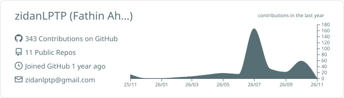
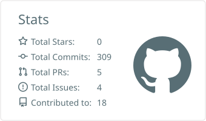
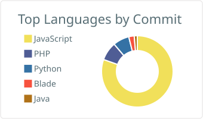
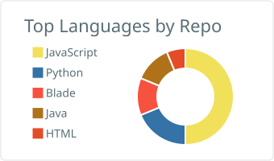

# Halo, saya Fathin Ahmad Zidan A

**Mahasiswa Teknik Informatika, Universitas Riau**

Berfokus pada rekayasa perangkat lunak *full stack*. Senang membangun aplikasi yang efisien, terstruktur, dan menyelesaikan masalah nyata.

 

---

<h2 align="center">Bahasa Pemrograman</h2>

  

<h2 align="center">Framework &amp; Library</h2>

  

---

<h2 align="center">Statistik GitHub</h2>

  
  

  
  

